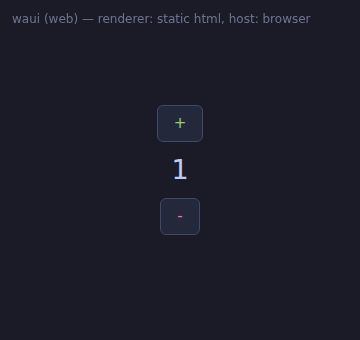
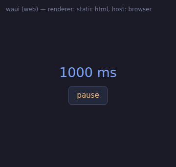
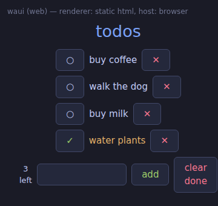
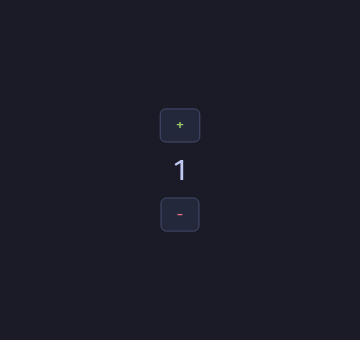
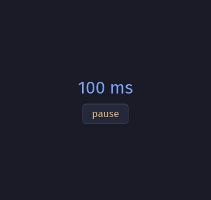
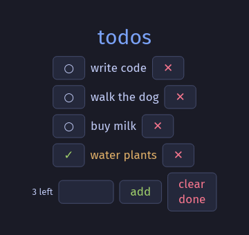
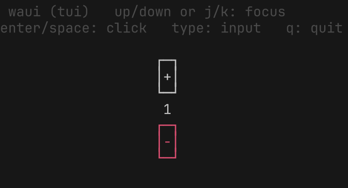
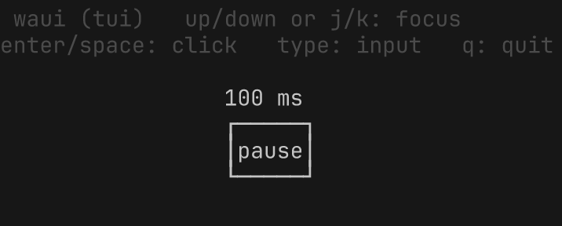
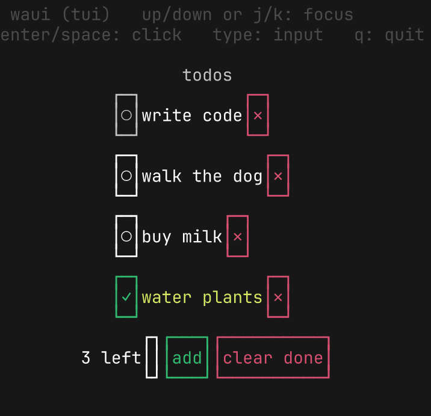

# waui

### WebAssembly User Interface types

A WIT world for UI components. The component owns all UI state and logic; it
exports its widget tree, and any host renders it. Adding a host requires no
component changes.

> **Slop warning:** this code was written by Qwen 3.8 27B (LM Studio) running in OpenCode on macOS. It had web search, a browser, and shell access while doing it. Read it before shipping.

## The contract (`wit/`, package `waui:ui`)

- **`widget` interface** — a minimal, renderer-agnostic widget tree: `text`,
  `button`, `input`, and `container` (row/column) records, a `node` variant,
  a semantic `style` (a color and a size token), and a `mutation` variant
  (`changed`, `removed`). The tree crosses the ABI as a flat, pre-ordered node
  list; the rules for the list, node identity, and the diff are documented in
  [`widget.wit`](wit/widget.wit).
- **`app` world** — the component/host protocol: the component exports `view`
  (the current tree) and `changes` (the diff), and the host calls `on-click`,
  `on-text`, and `on-tick`; the component imports `now` (a clock) and
  `schedule` (a refresh request). The protocol rules are documented in
  [`app.wit`](wit/app.wit). Hosts may ignore parts of the contract (host-cli
  ignores `style`, `align`, `changes`, and `schedule`); components cannot,
  because the node layout is part of the ABI.

**Authoring.** Component authors write a nested tree and project it onto the
flat list. Rust uses the [`component-ui`](crates/component-ui/) crate;
AssemblyScript uses [`assembly/ui/tree`](assembly/ui/tree.ts), documented in
[`assembly/README.md`](assembly/README.md).

## Layout

| path                     | what it is                                                                                          |
| ------------------------ | --------------------------------------------------------------------------------------------------- |
| `wit/`                   | the WIT contract (`widget` + `app`)                                                                 |
| `crates/host-shared`     | wasmtime host core: the bindings, the list→tree rebuild, the retained tree diffs apply against      |
| `crates/host-iced`       | windowed host (iced): a real text input; style → palette colors + point sizes; applies diffs, skips rebuild on empty diff; `--click <id>` injects clicks, `--dump <file>` renders a headless PNG, `--now <base> <step>` fakes the clock (test-only) |
| `crates/host-tui`        | terminal host (ratatui): real layout, framed buttons, an editable input, a host-local focus ring; style → ANSI colors + weight; `--dump` prints one frame, `--width <n>` sizes the dump buffer, `--now <base> <step>` fakes the clock (test-only) |
| `crates/host-cli`        | terminal host, ASCII tree, clicks and text lines via stdin; ignores `style`, `align`, the diff channel, and `schedule` |
| `web/`                   | web host: one self-contained HTML page per component (`glue.js` + `app.js` + base64 wasm), or a page that fetches the `.wasm` file when `--url` is passed (the site's mode); `expect.mjs` holds the expected views, shared with the selftest and the browser suite |
| `site/`                  | the GitHub Pages site: a desktop of demo icons; double-clicking one opens the demo in a small window, several at once; the pages fetch their `.wasm` files, so the site needs a server; deployed by `.github/workflows/site.yml` |
| `e2e/`                   | the Playwright browser suite: the nine demo pages — each walking its states — in a 360x340 viewport (the iced window size), and the site desktop, in chromium; the screenshot goldens are CI-only, the pixel-level producer parity runs everywhere |
| `crates/demo-counter`    | the counter: only the readout depends on state, so a click reports one mutation; it never requests a refresh (the host never wakes it) |
| `crates/demo-stopwatch`  | the stopwatch: polls `now()` and requests a 250ms refresh while running; a running wake reports one mutation |
| `crates/demo-todo`       | the todo list: the structural demo — the diff's add, remove, and re-parent through a real component; the footer's input takes typed text, and "add" uses it (a preset label when it is empty) |
| `assembly/`              | the same three demos in AssemblyScript: hand-rolled ABI (`abi/`), object tree layer (`ui/`)         |
| `wat/`                   | the same three demos in hand-rolled WAT: the WASM GC holds the state, the canonical ABI is written by hand, one self-contained file per demo |

The three wasmtime hosts load the same component file. The web host runs the
*pre-lift* core module instead (browsers instantiate core wasm, not components)
through a hand-rolled JS layer over the same ABI.

## Screenshots

Each demo, on each host, in each of the three source languages.

### Web

| Rust | AssemblyScript | WAT |
| :---: | :---: | :---: |
|  |  |  |
|  |  |  |
|  |  |  |

### Iced

| Rust | AssemblyScript | WAT |
| :---: | :---: | :---: |
|  |  |  |
|  |  |  |
|  |  |  |

### TUI

| Rust | AssemblyScript | WAT |
| :---: | :---: | :---: |
|  |  |  |
|  |  |  |
|  |  |  |

## Quick start

Prerequisites: stable Rust with the `wasm32-unknown-unknown` target
(`rustup target add wasm32-unknown-unknown`), `wasm-tools` on the PATH,
Node.js with `npm install` run (AS demos), and wabt (AS builds).

```sh
make components      # build the demos, lift them into target/components/
make run-cli         # counter, ASCII terminal host
make run-tui         # counter, TUI host
make run-iced        # counter, window
make run-stop-tui    # stopwatch, TUI host
make run-stop-iced   # stopwatch, window
make run-todo-cli    # todo, ASCII terminal host
make run-todo-tui    # todo, TUI host
make run-todo-iced   # todo, window
make web             # self-contained HTML pages in target/web/
make site            # the demo site in target/site/ (GitHub Pages)
make web-test        # headless (Node) check of the web host's ABI layer
make e2e             # the Playwright browser suite (needs `npx playwright install chromium`)
make test            # cargo test, all crates
make fmt             # format all sources (rustfmt + prettier)
make hooks           # point git at .githooks (the pre-commit gate)

make components-as   # build the AS demos, lift them
make run-tui-as      # counter from the AS component
make run-todo-tui-as # todo from the AS component
make web-as          # HTML pages for the AS components
make web-test-as     # the web selftest against the AS modules
make ui-test         # the tree layer's structural diff, run via Node

make components-wat  # build the WAT demos, lift them
make run-tui-wat     # counter from the WAT component
make run-todo-tui-wat # todo from the WAT component
make web-wat         # HTML pages for the WAT components
make web-test-wat    # the web selftest against the WAT modules
```

`make web` inlines the wasm module as base64 into one HTML file per component;
it runs from disk with no server and no network.

## GitHub Pages

`make site` assembles the demo site in `target/site/`: the desktop launcher
(`site/`), the nine demo pages, and their `.wasm` modules. The launcher is a
desktop — an icon per demo, title underneath; double-clicking one opens the
demo in a small window (an iframe over the page), and several windows may be
open at once. The pages fetch their `.wasm` file instead of inlining it, so
the site needs a server (GitHub Pages, or `python3 -m http.server`); the
launcher itself runs from disk, its demo windows do not (their fetch fails on
file://). It is deployed to GitHub Pages by `.github/workflows/site.yml` on
every push to main. Enabling it needs one manual step: repository
Settings → Pages → Source: *GitHub Actions*.

## Tests

- `cargo test`: `component-ui` unit tests (lowering pre-order and parent
  links), `host-shared` tests (diff application: in-place replace, subtree
  removal, re-parenting, insertion, id-less skip), and the round-trip test
  (`crates/host-cli/tests/roundtrip.rs`), which drives the counter, the
  stopwatch, and the todo through the same wasmtime host code the real hosts
  use and asserts on the node content, the style, the diff channel (the
  todo's is structural: add, remove, re-parent), the text event (the todo's
  input), and the refresh request (`schedule`). It runs against the Rust
  component, as `*_as` against the AssemblyScript one (skipped when
  `node_modules` is missing), and as `*_wat` against the hand-rolled WAT one
  (skipped when `wasm-tools` is missing).
- The hosts' headless render checks, also under `cargo test`: `host-tui`
  `tests/dump.rs` runs the binary with `--dump` (one frame into ratatui's
  test backend) and asserts on the layout, the semantic colors, and the
  focus ring; `host-iced` `tests/dump.rs` runs it with `--dump` (one frame
  through iced's software `tiny-skia` renderer into a PNG) and asserts on the
  background, the button chrome, the semantic colors, and the centered
  layout. Each runs against the Rust component, as `*_as` the AssemblyScript
  one (skipped when `node_modules` is missing), and as `*_wat` the WAT one
  (skipped when `wasm-tools` is missing). The iced render is headless — no
  window, display, or GPU — so it runs in CI.
- The dumps' goldens, the visual regression layer: each scenario's whole
  frame — the tui's text (with the SGR codes) and the iced's PNG — is
  byte-exact against `crates/host-{tui,iced}/tests/goldens/`, shared by the
  three producers (they must render identically, so the shared golden is
  also the parity check). The tui frame is text, so its goldens are
  platform-stable. The iced render is bundled-font software rasterization:
  the dump prunes the font database to the bundled fonts (Fira Sans plus a
  small symbol font covering the glyphs Fira lacks), so the iced goldens
  are platform-stable too. The stopwatch's running state reads the clock,
  so it runs on a fake one that advances (`--now <base> <step>`). A
  mismatch writes the actual frame next to the golden (`.actual`).
  `UPDATE_GOLDENS=1 cargo test` regenerates the goldens; the cargo ones
  are platform-stable, so any machine's render matches. The e2e
  screenshots are chromium-rendered and platform-specific — the
  workflow's `update_snapshots` input regenerates them on the CI platform
  (and the cargo goldens with them) for download and commit.
- `make web-test` (and `-as`, `-wat`): the same assertions from Node, against
  the core modules, through the same `glue.js` the browser page uses.
- `make ui-test`: the tree layer's diff channel, as a standalone module run
  via Node: the structural cases (add, remove, re-parent) plus the bootstrap,
  id-less, and input rules — the AS twin of the `component-ui` unit tests.
- `make e2e`: the Playwright browser suite (chromium) against the built
  site: the nine demo pages and the desktop in a real browser — the
  rendered DOM against the same expectations as the web selftest
  (`web/expect.mjs`), the computed styles, the in-place-vs-rebuild
  behavior, and the window management (open, raise, drag, resize, close).
  Screenshot goldens compare in CI only (font rendering is
  platform-specific): each demo page's states — the counter at 0, 1, and
  -3, the stopwatch paused and running, the todo seeded and after an add —
  in a 360x340 viewport (the iced window size), plus the desktop at
  1280x720. The parity spec (`e2e/parity.spec.mjs`) asserts the pixel-level
  twin of the DOM parity: the three producers of each demo render each state
  identically — within one browser, so it runs locally and in CI. Locally a
  one-time `npx playwright install chromium` is needed.
- `make fmt-check`: all sources are formatter-clean (`cargo fmt --check`
  for the Rust crates, prettier for the assembly/ and web/ trees). A
  pre-commit hook runs it on every commit (`make hooks` installs it);
  `make fmt` writes the formatting.

## Not implemented

- **Component-directed focus.** The host owns focus (arrow keys, the mouse);
  a component can only report state, not move it.
- **Images, as a WIT `resource`.** Substantial ABI work, worst on the
  hand-rolled AS side.
- **Multi-component hosts.** Host-side only.
- **Grid layout.** The contract's containers are rows and columns (one axis
  each); a grid — placing children on two axes at once — has no token.
- **Stretch / equal-width.** `align` places children on the cross axis but
  never stretches them to fill it or equalizes their sizes; a host that does
  so is applying its own layout, not the contract's.

## Known limitations

- **Rust heap fragmentation under text input.** Each `on-text` and `changes`
  round-trip allocates short-lived buffers of varying size, which fragment
  the Rust heap (dlmalloc). The Rust web todo demo traps after a few adds.
  The AssemblyScript and WAT demos are immune: their string buffers come from
  a bump arena that resets on free (AssemblyScript) or from the WASM GC
  (WAT), and the result arena is a fixed region that resets on every post
  call. The selftest (the byte-parity gate) stays below the threshold, so it
  passes for all three.
